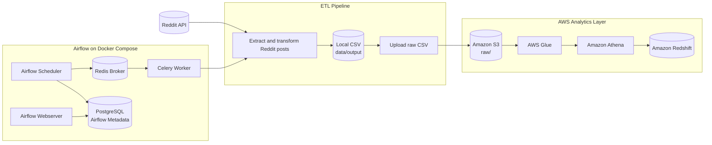
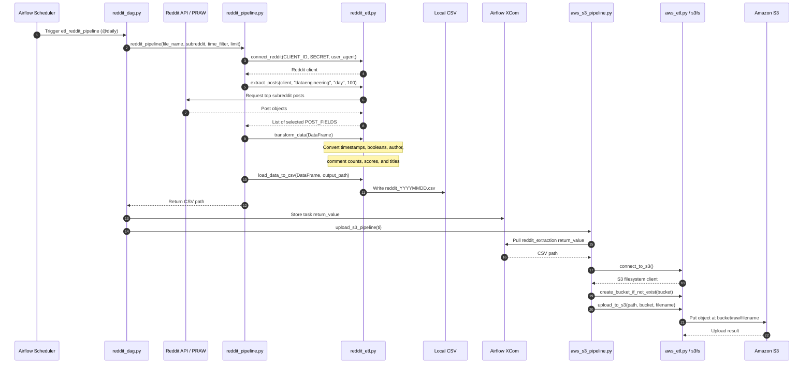

# Data Pipeline with Reddit, Airflow, Celery, Postgres, S3, AWS Glue, Athena, and Redshift

This project provides a comprehensive data pipeline solution to extract, transform, and load (ETL) Reddit data into a Redshift data warehouse. The pipeline leverages a combination of tools and services including Apache Airflow, Celery, PostgreSQL, Amazon S3, AWS Glue, Amazon Athena, and Amazon Redshift.

## Table of Contents

- [Overview](#overview)
- [Architecture](#architecture)
- [Prerequisites](#prerequisites)
- [System Setup](#system-setup)

## Overview

The pipeline is designed to:

1. Extract data from Reddit using its API.
2. Store the raw data into an S3 bucket from Airflow.
3. Transform the data using AWS Glue and Amazon Athena.
4. Load the transformed data into Amazon Redshift for analytics and querying.

## Architecture

1. **Reddit API**: Source of the data.
2. **Apache Airflow & Celery**: Orchestrates the ETL process and manages task distribution.
3. **PostgreSQL**: Temporary storage and metadata management.
4. **Amazon S3**: Raw data storage.
5. **AWS Glue**: Data cataloging and ETL jobs.
6. **Amazon Athena**: SQL-based data transformation.
7. **Amazon Redshift**: Data warehousing and analytics.

## High-Level Design (HLD)



## Low-Level Design (LLD)




## Prerequisites
- AWS Account with appropriate permissions for S3, Glue, Athena, and Redshift.
- Reddit API credentials.
- Docker Installation
- Python 3.9 or higher

## System Setup
1. Clone the repository.
   ```bash
    git clone https://github.com/0xs1d/Reddit-airflow-aws.git
   ```
2. Create a virtual environment.
   ```bash
    python3 -m venv venv
   ```
3. Activate the virtual environment.
   ```bash
    source venv/bin/activate
   ```
4. Install the dependencies.
   ```bash
    pip install -r requirements.txt
   ```
5. Rename the configuration file and the credentials to the file.
   ```bash
    mv config/config.conf.example config/config.conf
   ```
6. Starting the containers
   ```bash
    docker-compose up -d
   ```
7. Launch the Airflow web UI.
   ```bash
    open http://localhost:8080
   ```
